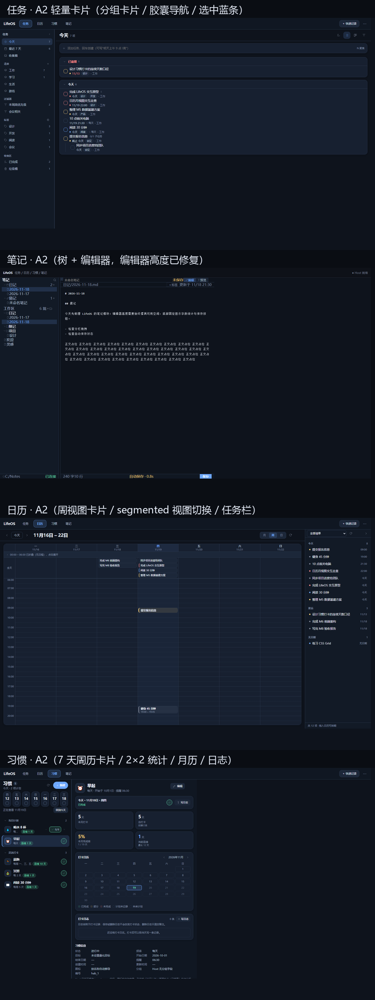

# LifeOS · DSH 个人管理智能助理插件

LifeOS 是一个运行在 [DeepSeek Harness](https://github.com/deepseek-ai)（DSH）里的个人管理插件。它不是又一个待办 App，而是把 **任务 / 日历 / 习惯 / 笔记** 放进同一个工作区，并让 DSH 里的 Agent 能直接读写这些数据，帮你完成「记录 → 整理 → 安排 → 复盘」的闭环。

> 当前版本：`v0.2.0`。四个 Tab 可用。
> 当前里程碑、测试数与最近验收 commit 以 [STATUS.md](STATUS.md) 为准；用户反馈进度见 [docs/product/backlog.md](docs/product/backlog.md)。



## 设计理念

**1. 低摩擦优先**
记录时不需要先想「它属于哪个清单」。快速记录浮层（`Ctrl/Cmd+Shift+Space`）提供两个出口：**收集箱任务** 和 **随记**；分类可以稍后再补，先让想法落到系统里。

**2. 一个工作区，而不是四个孤岛**
任务带日期就出现在日历里，习惯打卡进入统计与月历，笔记可以随时转成任务。四个 Tab 共享同一份数据与上下文，不需要在应用之间搬运。

**3. 本地优先**
业务数据存放在本机 DSH 存储目录（JSON），笔记是你磁盘上的 Markdown 文件。离线可用、无账号、无云端同步；备份和迁移就是复制文件。

**4. Agent 是协作者，不是唯一入口**
所有界面操作都不依赖模型；Agent 通过受控工具（`lifeos_task`、`lifeos_habit`、`lifeos_notes` 等）做批量整理、查询和总结。界面始终是主路径，Agent 负责降低整理成本。

**5. 原生融合**
沿用 DSH 的深色主题、布局 token 与三栏结构，不另起一套视觉语言，避免在 DSH 内出现「另一个应用」。

**6. 渐进式自动化**
先让手动流程跑通，再逐步打开重复任务、提醒、Agent 整理。默认克制：不打扰、不替用户做不可逆决定。

## 四个 Tab 的基本用法

### 任务

- 左侧固定「今天 / 最近 7 天 / 收集箱 / 清单 / 过滤器 / 已完成 / 垃圾桶」入口；清单下可建分组，任务支持标签、优先级、子任务（最多三层）。
- 顶部输入框直接输入自然语言：`明天上午 9 点 交周报 !高`，会解析日期/时间/优先级；Enter 创建，焦点留在输入框，方便连续录入。
- 行内操作：点圆圈完成（可撤销）、点标题就地改名、点行主体打开右侧详情；详情里可改日期、时间段、优先级、清单/分组、标签、备注。
- 日期入口使用共享的 `V2DatePicker`（可切月、回到今天、清空、快捷相对日期）。
- 过滤支持多条件 AND；条件保存在本机 `localStorage['lifeos.v2.filters']`。
- 支持列表 / 看板两种视图、清单与分组拖拽排序、批量移动/打标签/删除；删除进垃圾桶，可恢复。
- 重复任务：每天 / 每周指定日 / 每月指定日，完成后生成下一次；无日期的重复任务会按规则补上最近一次日期。
- 每个清单可独立选择「已完成」的显示方式：原位划线 / 移入分组内置底「已完成」分组（默认）/ 本清单不显示。

### 日历

- 月 / 周 / 日三种视图；周与日视图是时间网格，任务按开始/结束时间绘制成块。
- 点空白时间格或拖选时间范围可直接创建任务；周/日视图的拖选有 15 分钟吸附与选区高亮。
- 点任务块打开的是日历专用的紧凑编辑弹窗（标题、全天、起止、优先级、清单、重复、备注、标签），**不是**任务 Tab 的完整详情；分组、子任务、截止日期需要回任务 Tab 编辑。
- 拖动任务块改期，拖动块的下边缘调整持续时长；月视图可把任务拖到日期格，拖出月历网格即移入垃圾桶。
- 跨日任务在月视图按天切段显示；周/日视图按天裁剪绘制。跨日的 timed 段暂不支持直接拖动改期。
- 顶部日期标题可点击弹出月历，选择后按当前视图跳转；右侧任务栏收纳「今天 / 更远 / 无日期」的未排期任务，可直接拖入日历，并支持按清单/分组分组与多种排序。
- 默认打开哪个视图可在 **设置 → LifeOS → 日历** 中配置。

### 习惯

- 左侧是最近 7 天的日期条 + 当日习惯列表，点日期切换查看；右侧是详情与统计。
- 打卡圆钮支持四态（完成 / 部分 / 跳过 / 未完成）；量化习惯可加减计数；错过可补记。
- 统计包含本月打卡数、完成率、当前与最长连续天数、月历矩阵和打卡日志；日志不会改变打卡状态。
- 频率支持每天 / 每周指定星期 / 每周 N 次 / 间隔 N 天；习惯可暂停、归档，暂停的习惯可在设置里隐藏。
- 习惯按一级分组组织：可新建、双击重命名、拖拽调整顺序、点箭头折叠（折叠状态保存在 Host）；删除分组时组内习惯回到「未分组」。
- 每个习惯可设 emoji 图标（最近使用 8 个 + 常用矩阵，也可恢复按名称推导）；双击标题可 inline 重命名；把习惯拖到另一行可调整组内/跨组顺序。

### 笔记

- 采用本地文件夹 + Markdown：默认推荐 `日记/YYYY-MM-DD.md` 与 `随记/*.md`，其余目录当笔记本用。
- 左侧文件树支持搜索、多选、拖拽移动；右侧编辑器有编辑/预览、自动保存（延迟可在设置中调）、`Ctrl/Cmd+S` 立即保存。
- 首次使用会引导选择笔记目录（不存在会自动创建）；所有内容只保存在本地磁盘。
- 外部修改同一文件时提示冲突；删除进入目录内 `.trash`，可手动恢复。
- 设置中可调编辑器字号（小 / 标准 / 大 / 特大），字号同时作用于编辑与预览；编辑器内也可循环切换。

### 快速记录与设置

- `Ctrl/Cmd+Shift+Space`：快速记录浮层，选择「收集箱任务」或「随记」。
- `N`：新建任务；`/`：搜索；`Esc`：逐层关闭面板/弹层。
- **设置 → LifeOS**：默认页签、任务默认视图/排序、日历默认视图、习惯已暂停显隐、笔记自动保存与字号、恢复默认设置。设置保存在本机 `localStorage['lifeos.v2.settings']`。

## 安装与部署（DSH 插件）

### 前置条件

- DSH Desktop（或带插件能力的 DSH），并已能打开 **设置 → 插件**。
- Node.js 22+（仅用于构建/测试；运行由 DSH 自带运行时负责）。
- Windows / macOS / Linux 均可；本仓库主要在 Windows 上开发和验证。

### 安装步骤

1. 克隆仓库到固定路径（不要放在会被清理的临时目录）：

   ```powershell
   git clone https://github.com/Roy2029/dsh-lifeos.git D:\Tools\dsh-lifeos
   ```

2. 把插件登记到 DSH 的 profile（DSH 使用 pnpm workspace，profile 目录通常是 `%USERPROFILE%\.dsh\profiles\desktop`）。

   编辑 profile 的 `package.json`，加入依赖与 bundle：

   ```jsonc
   {
     "dependencies": {
       // 新增：指向你的克隆目录
       "dsh-lifeos": "link:D:/Tools/dsh-lifeos"
     },
     "dsh": {
       "profile": {
         "bundles": [
           // ...原有 bundles...
           "dsh-lifeos"
         ]
       }
     }
   }
   ```

   然后在 profile 目录安装依赖：

   ```powershell
   cd "$env:USERPROFILE\.dsh\profiles\desktop"
   pnpm install
   ```

   > 也可以让 DSH 的插件管理器安装本地路径（`file:`/`link:` 规格）；如果你更习惯图形界面，用它安装后确认 `dsh.profile.bundles` 中出现 `dsh-lifeos` 即可。

3. 重启 DSH。若插件未自动启用，打开 **设置 → 插件** 启用 `dsh-lifeos`（LifeOS）。
   - 插件通过 `dsh.bundle.patch` 注册 Host 服务、HTTP 路由、Agent 预设与侧栏入口。
   - 启用后左侧栏出现 **LifeOS** 图标，主面板即四个 Tab。

4. 打开 **设置 → LifeOS** 调整默认视图/字号等；首次进入 **笔记** Tab 时按引导选择本地笔记目录。

5. 验证：侧栏出现 LifeOS；四个 Tab 能读写；重启 DSH 后设置仍保留；数据目录出现 `lifeos*.json`。

> 升级：`git pull` 后若 `client-v2/` 有改动，先执行 `node scripts/build-v2.mjs`，再重启 DSH。
>
> 卸载：从 profile `package.json` 的 `bundles` 与 `dependencies` 中移除 `dsh-lifeos`，执行 `pnpm install`，再重启 DSH。业务数据不会被删除。

### 配置项

插件的挂载声明在 `cordis.patch.yml`，可在 DSH 配置中覆盖：

| 键 | 默认值 | 说明 |
| --- | --- | --- |
| `enabled` | `true` | 是否启用插件 |
| `timeZone` | `Asia/Shanghai` | 任务/统计使用的 IANA 时区 |
| `devMode` | `false` | 开启后允许开发者接口（`/api/lifeos/dev/*` 等），日常请关闭 |
| `clientSelfCheck` | `false` | 浏览器端自动自检（发版验收用），日常请关闭 |
| `httpPrefix` | `/api/lifeos` | HTTP 路由前缀 |
| `diagnosticsPath` | 插件运行目录 | 诊断 JSON 输出路径 |

插件版本由 `index.js` 从 `package.json` 读取，不再单独维护一份版本号。

## 数据与隐私

| 内容 | 位置 |
| --- | --- |
| 业务数据（单记录单元） | `%USERPROFILE%\.dsh\storages\lifeos.json` |
| 原始记录 / 收件箱 | `%USERPROFILE%\.dsh\storages\lifeos_raw\` |
| 操作日志 / journal | `%USERPROFILE%\.dsh\storages\lifeos_log\` |
| 笔记 | 你在笔记 Tab 中选择的本地文件夹（Markdown） |
| 界面偏好 | 浏览器 `localStorage`（按 DSH 来源隔离） |

- 不做云同步、不上传数据；schema 升级前会自动备份（保留最近 5 份 `lifeos.json.bak-*`）。
- 备份：退出 DSH 后复制上述目录即可；恢复同理。笔记目录可直接用任意 Markdown 工具迁移。
- 卸载插件不会删除业务数据；如需彻底清理，手动删除上述目录。

## 开发

```powershell
cd D:\Tools\dsh-lifeos

# 修改 client-v2/*.js 后重新内联到 client.js
node scripts/build-v2.mjs
node --check client.js

# 全量测试（Node 22+ 自动发现 test/**/*.test.mjs）
npm test

# 代码 + 文档一致性门禁（版本、测试数、backlog、计划、链接）
npm run check
```

### 项目结构

```
index.js / agent.js        Host 入口与 Agent 薄行
src/
  domain/                  领域模型、校验、时间与任务状态机
  store/                   3 个 kv unit、journal 事务与恢复
  application/             服务层（任务/笔记/习惯/项目/目标/整理）
  runtime/                 HTTP 路由、SSE、调度、诊断
  agent/                   Agent 工具与预设
  client-shared/contract.js  Host 与测试共享的契约
client-v2/                 客户端源码（无构建框架，lazy-CJS）
  00-core / 05-tokens / 10-shell / 15-datepicker
  20-tasks / 30-calendar / 40-habits / 50-notes / 60-settings
client.js                  构建产物：内联了 client-v2 模块
scripts/build-v2.mjs       内联脚本
scripts/spec-sync.mjs      文档/状态一致性检查器
docs/plans/                里程碑计划（完成的移入 archive/）
docs/product/backlog.md    用户反馈与交付证据
STATUS.md                  当前版本、里程碑、测试数、最近验收
test/                      单元与集成测试
locale/                    中英文插件元信息
```

- Host 使用 DSH 的 kv 存储（JSON），无 SQL/索引；写入采用 journal-first 逻辑事务。
- 客户端是单文件 lazy-CJS bundle（`window.__ModuleLoader__.load`），无 JSX、无打包器；`client-v2/*.js` 按顺序内联进 `client.js`，因此新增模块后要重新 build。
- 所有 UI 改动需要**重启 DSH**（或至少刷新页面）以确保加载新的客户端 bundle；Host 改动需要重启 Host 进程。

## 文档与状态管理

这个仓库使用 `spec-sync` 约定，避免代码和文档再次漂移：

- `STATUS.md` 是当前状态的唯一来源（版本、里程碑、阶段、测试数、最近验收）。
- `docs/product/backlog.md` 一行一条用户可见项，`done` 必须带证据。
- `docs/plans/` 只放进行中的计划，完成的移入 `docs/plans/archive/`。
- README 只写稳定用法，不写「当前测试数」「下一阶段」这类易变事实。
- 提交前运行 `npm run check`；它会在版本/测试数/backlog/计划/本地链接不一致时失败。

## 已知限制

- 日历任务块打开的是紧凑编辑弹窗，字段少于任务 Tab 的完整详情；要编辑分组/子任务/截止日期请回任务 Tab。
- 跨日的 timed 段在周/日视图中暂不支持直接拖动改期；多日段在任务栏会占整列 lane。
- 周起始固定周一；农历/节假日尚未支持。
- 项目 / 回顾 Tab 在 V2 中暂时隐藏（Host 服务保留）。
- 笔记编辑器为 Markdown 源码 + 基础预览，未做完整富文本（M19）。
- Agent 浮窗与数据看板尚未排期。
- 主题系统由外部团队负责，不在本机里程碑内。

## Roadmap

- [x] M15 稳定与一致性（inline、批量、页面状态、搜索、字号、草稿）
- [x] M16 日期与日历（共享日期选择器、跨日、拖选、已完成模式、重复补日期）
- [x] M18 习惯体系（习惯分组 + emoji 图标 + inline 标题 + schema v4）
- [ ] M19 笔记 Markdown 与导入导出（先定 `@` 注释映射规范）
- [ ] 周起始日、农历/节假日（未排期）
- [ ] 项目与回顾工作区回归（未排期）
- [ ] Agent 浮窗 / 数据看板（未排期）

## License

[MIT](LICENSE)
